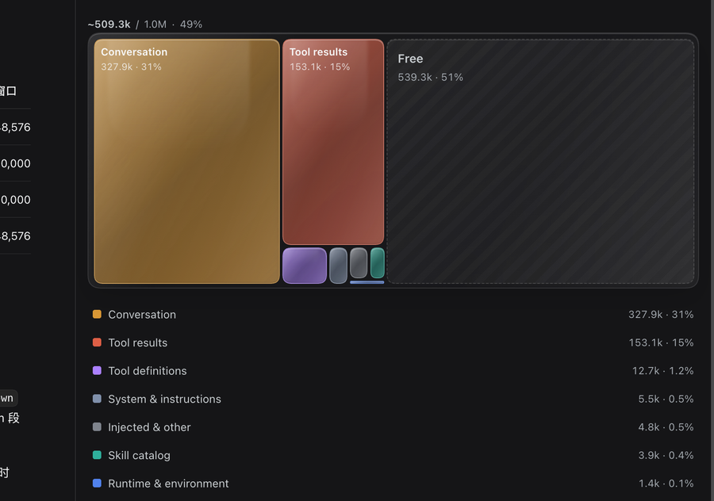
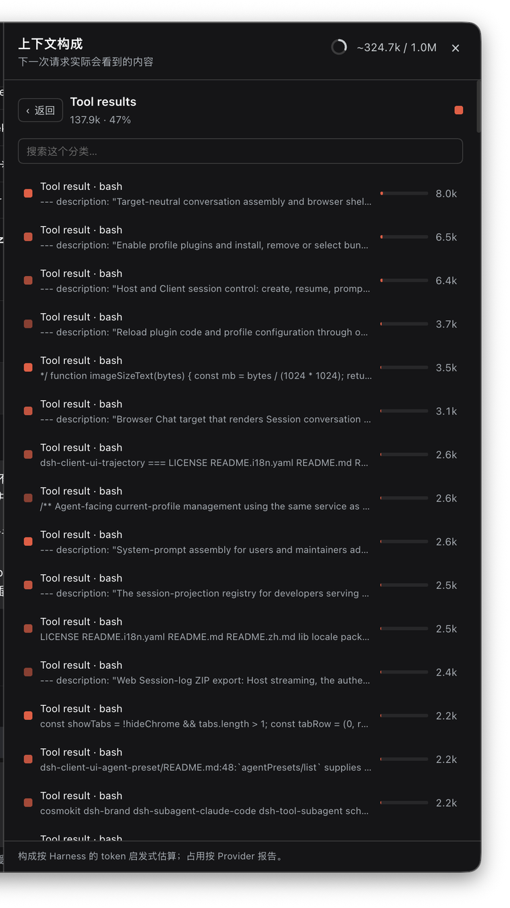

# Context Mekko



A DSH plugin that adds a **Context** tag to the conversation header and opens a
native **right Sidebar tab** with a live **squarified treemap** of the
model-visible context window. Click a category tile to open its contributions
and inspect the exact content that was sent to the model.

- Header entry: `Context` pill with the provider-reported occupancy percentage.
- Native tab: the chart lives in a normal right Sidebar tab, with the panel's
  own close, split, fullscreen, drag/dock, and layout persistence behavior.
- Liquid glass: translucent frosted blocks, refractive highlights, and smooth
  size transitions make the chart feel like a living glass mosaic.
- Live: the tab refreshes on committed session events (debounced) while it is
  open; the header percentage follows the existing `contextPressure`
  projection continuously.
- Hierarchical drill-down: category tile → semantic groups (Conversation:
  User/Assistant; tool results: tool name; system: prompt/instructions) →
  contribution treemap and searchable list → the rendered content, with token
  estimates and source metadata. Categories with only one group skip the group
  level.

Clicking the header tag opens or focuses the `Context` tab in the right
Sidebar. Opening a category first shows its groups; opening a group shows its
contribution treemap and list; opening a contribution shows the exact message,
tool output, tool schema, runtime section, or skill entry:


- Zero model impact: the plugin adds no model-visible content, writes no
  session events, and makes no model calls.

## What is in the chart

The chart follows the current retained model-visible surface, not the raw
session history. **The whole chart area represents the full context window**:
every category is one tile, laid out with a squarified treemap so tile area is
proportional to its token share, and the neutral **Free** tile is the remaining
space anchored to the right edge. Used area and Free follow provider-reported pressure when available
(with category proportions taken from the estimated breakdown); otherwise they
fall back to the estimated total. Larger tiles show their own label, token
count, and percentage; smaller tiles keep their tooltip and legend entry.

Categories:

| Category | Contents |
|---|---|
| System & instructions | Rendered system prompt, workspace instructions, developer tool context |
| Tool definitions | The tool schemas in the latest `request/header` |
| Skill catalog | The skill-catalog context message and its entries |
| Runtime & environment | Runtime-context and time-context sections (cwd, sandbox, approval, team, harness, web surface) |
| Conversation | User and assistant messages on the surface |
| Tool results | `tool/result` nodes, grouped by tool name |
| Injected & other | Team/agent messages, goal/plan/reminder injections, job notices, compaction products, future source kinds |

`skill` tool results are labelled with the loaded skill name (for example
`Skill · frontend-design`) instead of the generic tool name, and that name is
also used as their Tool results subgroup.

Token counts reuse the same fixed heuristic as
`@deepseek-ai/dsh-token-meter` (four characters per token plus structural
overhead), so the composition agrees with the harness's existing
`contextBreakdown`. Occupancy in the header uses the provider-reported
`contextPressure` instead; the two figures are deliberately labeled differently.

## Install

DSH must be in **Creator** mode (or a profile with `plugin_manager` enabled).
From the web UI open **Plugins → Add plugin** and ask the agent to install this
repository, or use the `plugin_manager` tool directly:

```text
plugin_manager(action: "install_bundle", target: "github:Jacky-li-li-li/dsh-context-mekko")
```

The Web **Plugins → Add plugin** dialog accepts the same repository URL
(`https://github.com/Jacky-li-li-li/dsh-context-mekko`).

For a local checkout, link the package directory instead:

```text
plugin_manager(action: "install_bundle", target: "/absolute/path/to/context-mekko")
```

Then click the **Context** pill in the conversation header; DSH opens or
focuses the `Context` tab in the right Sidebar. Reload the page only if the
header entry itself is not visible yet.

### Development install

A checkout can be linked directly into a profile:

```bash
dsh plugin --profile <profile> add "link:/absolute/path/to/dsh-context-mekko"
```

`dsh plugin add` also adds the bundle to `dsh.profile.bundles`; HMR picks the
change up in a live profile. The workspace where this plugin was developed used
that path because an already-started session cannot switch Agent presets.

## Development

The package is plain JavaScript; there is no build step.

```bash
node --check index.js
node --check client.js
```

`index.js` is the Host half: it registers two authenticated GET routes under
`/api/context-mekko`. `client.js` is the browser half: it registers the header
entry, a `sidebarRightTabs` page type, and its `sidebar.right.pane.tab` body
with React from the host module table.

## Limitations

- Token figures are estimates. The fixed heuristic underprices CJK text and
  JSON schemas; the header occupancy percentage is provider-reported and may
  differ from the composition total.
- The system prompt is stored in the log as one rendered text node, so this
  version cannot split it into its internal sections.
- The skill catalog carries skill names and descriptions only; full `SKILL.md`
  bodies are not part of the context and are not shown.
- Long sessions are recomputed on demand when the tab is active; the plugin
  does not keep a background projection.
- Rendering is bounded: a nested treemap caps at 200 tiles (the remainder
  collapses into one "Other" tile), and the detail list renders 200 rows at a
  time behind "Show more". Content is still fetched only when a contribution is
  opened, so large sessions do not accumulate content strings or timers in the
  client.

## Performance guard

The chart and list are intentionally bounded for long sessions:

- `MAX_TILES = 200`: inputs above 200 collapse into one aggregate tile.
- `MAX_LIST_ROWS = 200`: the list grows only when the user asks for more.
- Content bodies are fetched lazily and are not cached by the browser plugin.

A local Node benchmark of the extracted layout function gave the following:
200/1k/5k/20k input items all chart at 200 tiles, one layout taking roughly
0.24–1.03 ms and leaving about 25–42 KB after GC. The live UI keeps one
ResizeObserver for the active chart, not one per tile.
- The tab shows the current session only. Sub-session aggregation is future
  work.

## License

MIT
